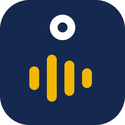
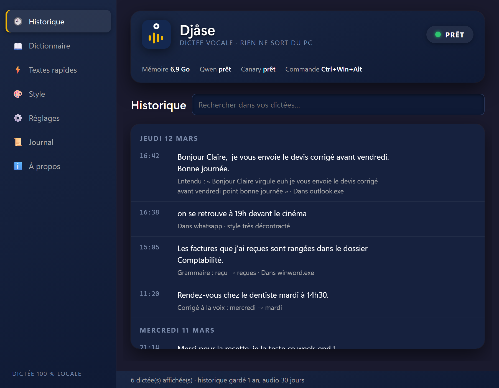

<p align="center"></p>

<h1 align="center">Djåse</h1>

<p align="center"><b>La dictée vocale qui reste sur votre PC.</b><br>Vous parlez, le texte s'écrit, dans n'importe quel programme de Windows.</p>

<p align="center">
  <a href="https://github.com/ManuelWarland/djase/releases/latest"><b>Télécharger l'installateur</b></a> ·
  <a href="guide/sortie/Djase_Mode_emploi.pdf"><b>Mode d'emploi (PDF)</b></a>
</p>


Maintenez <kbd>Ctrl</kbd>+<kbd>Win</kbd>, parlez, relâchez : le texte arrive là où se trouve le curseur. Un courriel, un message WhatsApp, un document Word, une conversation avec une IA... c'est pareil partout.

**Tout se passe sur votre PC.** Pas de compte, pas d'abonnement, pas de serveur : votre voix ne part jamais sur Internet. Les modèles sont téléchargés une seule fois, au premier lancement. Ensuite, Djåse marche même sans connexion.



## Ce qu'il sait faire

- **Un texte propre** : les « euh » et les hésitations disparaissent, une reprise comme « mardi, non, plutôt mercredi » devient « mercredi », la ponctuation se place, Grammalecte corrige les accords.
- **La ponctuation à la voix** : « virgule », « point d'interrogation », « à la ligne », « ouvrez les guillemets », les listes à tirets, la touche Entrée pour envoyer un message.
- **Des corrections à la voix** : « Djåse, efface », « Djåse, efface tout », « Djåse, corrige Martin par Marten et retiens ».
- **La mise en forme** : gras, italique, barré, citation, dans le format de l'application (WhatsApp, Markdown, ou texte simple pour Word et Outlook).
- **Vos mots** : un dictionnaire pour les noms propres et les termes de métier, réglable par application.
- **Des textes rapides** : « insère mon adresse » écrit votre adresse complète, avec la date et l'heure si vous le souhaitez.
- **Un style par application** : soigné dans Word, décontracté dans WhatsApp.
- **Les mains libres**, le recollage de la dernière dictée, un mode commande, un historique avec réécoute.

Tout est expliqué dans le [mode d'emploi](guide/sortie/Djase_Mode_emploi.pdf) (13 pages), installé aussi avec Djåse.

## Installer

1. Téléchargez `Djase-0.1.0-installation.exe` dans les [versions publiées](https://github.com/ManuelWarland/djase/releases/latest).
2. Lancez-le. Pas besoin de droits d'administrateur : Djåse s'installe pour votre compte Windows seulement.
3. Au premier lancement, Djåse télécharge ses modèles (environ 4,3 Go, depuis Hugging Face). Une coupure ne fait rien perdre : le téléchargement reprend là où il s'était arrêté.

Windows peut avertir qu'il ne connaît pas l'éditeur de l'installateur (il n'est pas signé) : choisissez **Informations complémentaires**, puis **Exécuter quand même**.

### Ce qu'il demande

- Windows 11, 64 bits, et un micro.
- Environ 4,5 Go de place sur le disque C:.
- De la mémoire vive : environ 7 Go quand tout est chargé. Sans la relecture par Qwen (elle se coupe dans les Réglages), environ 2,5 Go.
- Pas de carte graphique : tout tourne sur le processeur.

## Comment il s'y prend

Pendant que vous parlez, plusieurs moteurs de reconnaissance écoutent. Pour une vraie phrase, c'est Canary, de NVIDIA, qui écrit le texte. Pour un mot seul ou une commande brève, trois moteurs comparent ce qu'ils ont entendu, et le plus sûr l'emporte : c'est là qu'une dictée se trompe le plus souvent.

Vient ensuite la relecture. Un petit modèle de langue, Qwen3 4B, enlève les hésitations et les reprises. Grammalecte termine par les accords et les conjugaisons dont il est certain.

| Rôle | Composant | Licence |
|---|---|---|
| Reconnaissance de la voix | Parakeet TDT 0.6B v3, Canary 1B v2, FastConformer français (NVIDIA), versions ONNX par istupakov et OpenVoiceOS | CC-BY 4.0 |
| Relecture du texte | Qwen3 4B Instruct 2507 (équipe Qwen), lancé par llama.cpp | Apache 2.0, MIT |
| Grammaire | Grammalecte | GPL 3 |

La liste complète des composants et de leurs licences est dans [MENTIONS.md](MENTIONS.md).

## Vos données

Tout ce qui vous est propre (historique, son des dictées, dictionnaire, textes rapides, réglages, journal) est rangé dans `%LOCALAPPDATA%\Djåse`, jamais dans le dossier du programme. L'historique est gardé un an, le son trente jours, et les deux se coupent dans les Réglages. Désinstaller Djåse garde ces données ; supprimez ce dossier pour tout effacer.

Le seul accès à Internet est le téléchargement des modèles, au premier lancement.

## Partir du code

Pour lancer Djåse depuis le code source (Python 3.13, Windows 64 bits) :

```bat
python -m venv .venv
.venv\Scripts\python.exe -m pip install -r requirements.txt
.venv\Scripts\python.exe -m pip install grammalecte-fr-v2.3.0.zip
```

- Grammalecte 2.3.0 n'est pas sur PyPI : son archive Python se télécharge sur [grammalecte.net](https://grammalecte.net/).
- `llama-server` vient de [llama.cpp](https://github.com/ggml-org/llama.cpp/releases) (version b11796, archive Windows pour processeur x64) : décompressez-la dans un dossier `llama\` à côté de `dictee.py`.
- Les modèles se téléchargent seuls au premier lancement.

Ensuite : `Lancer dictee.cmd` (avec une console qui montre le journal).

**Fabriquer l'exe et l'installateur** : `pyinstaller --noconfirm djase.spec` produit `dist\Djase\`, puis [Inno Setup 6](https://jrsoftware.org/isinfo.php) compile `djase.iss`. Le mode d'emploi se refabrique avec `guide\build.py` (Chrome ou Edge) ; ses captures viennent de `guide\maquette.py`, qui sert la vraie fenêtre de Djåse avec des données inventées.

## Pourquoi « Djåse » ?

En wallon de Liège, « djåse » veut dire « parle », « cause ». Le å n'a rien de nordique : l'écriture du wallon s'en sert pour un son entre le « a » et le « o ».

## Qui l'a fait

Djåse est né le 21 octobre 2026, à Liège, chez Manuel Warland, qui voulait le confort d'une dictée en ligne sans que rien ne quitte son PC. Il l'a imaginé, essayé et corrigé à la voix, jour après jour. Le code a été écrit avec Claude, l'IA d'Anthropic ; Codex, d'OpenAI, et GLM l'ont relu et ont soufflé plusieurs idées.

## Licence

Djåse est un logiciel libre, sous licence [GNU GPL 3](LICENSE) : vous pouvez l'utiliser, l'étudier, le modifier et le redistribuer, en laissant les mêmes libertés à ceux qui le reçoivent. Il est fourni sans aucune garantie.

© 2026 Manuel Warland
